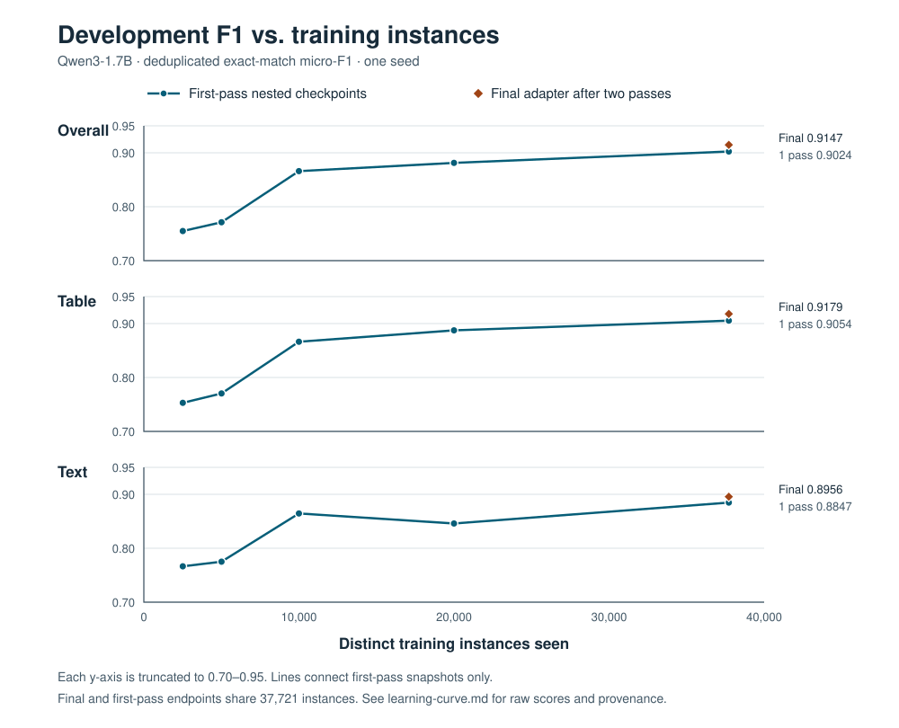

# Development learning curve

[View the chart](./checkpoint-f1.svg) · [Methods](./methods.md) · [Results](./results.md)



Qwen3-1.7B, seed 1, held-out **development** filings; these are not public FinNI test scores.
The five `P` rows are nested first-pass checkpoints. `Final` is the adapter after two passes over the
same distinct instances, not a larger training subset. F1 is pooled exact-match micro-F1 on normalized
value/type pairs. Deduplicated results are primary; raw scores are shown beside them.

| Checkpoint | Distinct seen | Step | Raw F1 | Raw table | Raw text | Dedup F1 | Dedup table | Dedup text | Parse failures raw / dedup | Cut-offs raw / dedup |
|---|---:|---:|---:|---:|---:|---:|---:|---:|---:|---:|
| P2,500 | 2,512 | 157 | 0.7548 | 0.7530 | 0.7658 | 0.7549 | 0.7530 | 0.7665 | 10 / 10 | 10 / 10 |
| P5,000 | 5,008 | 313 | 0.7710 | 0.7704 | 0.7741 | 0.7712 | 0.7704 | 0.7751 | 6 / 6 | 6 / 6 |
| P10,000 | 10,000 | 625 | 0.8659 | 0.8663 | 0.8638 | 0.8660 | 0.8663 | 0.8645 | 3 / 3 | 3 / 3 |
| P20,000 | 20,000 | 1,250 | 0.8812 | 0.8874 | 0.8455 | 0.8813 | 0.8874 | 0.8459 | 0 / 0 | 0 / 0 |
| P37,721 | 37,721 | 2,358 | 0.9023 | 0.9054 | 0.8839 | 0.9024 | 0.9054 | 0.8847 | 0 / 0 | 0 / 0 |
| Final | 37,721 | 4,716 | 0.9147 | 0.9179 | 0.8953 | 0.9147 | 0.9179 | 0.8956 | 1 / 1 | 0 / 0 |

`P2,500` and `P5,000` cross their targets at optimizer-batch boundaries, hence the actual x-values.
The decontaminated corpus contained 38,788 training instances, below the configured 40,000 cap (O-016);
1,067 over-length sequences were skipped, leaving 37,721 trained instances (T-018). The dev set has
1,933 raw / 1,920 deduplicated instances: table 637 / 637 and text 1,296 / 1,283. No response was
marked not generated. Parse failures count as empty predictions; cut-off responses are scored as written.

At the same 37,721 distinct instances, the final adapter's deduplicated F1 is 0.9147 versus 0.9024 after
one pass. This is a descriptive comparison within one training trajectory, not an independent
training-size experiment. Table F1 is below text at the first two checkpoints, but above it thereafter;
it does not lag at every size. Decontamination removed long table positives disproportionately (O-017).
The independent curve-validation run was cut (T-043), the human label audit is incomplete, and neither a
confidence interval for this same-x comparison nor a benchmark/generalization claim is supplied here.

## Sources and verification

All six source score reports were independently re-scored from their saved predictions on the same dev
IDs; raw and deduplicated results, including slices and per-instance counts, matched exactly. Oracle
calibration and the curve/chart tests passed. The [scorer](../../scripts/score_predictions.py),
[curve aggregation](../../scripts/curve_table.py), [chart specification](../../scripts/charts.py),
[artifact checks](../../tests/test_dev_curve_artifacts.py), and [run ledger](../../data/kaggle/runs.jsonl)
are tracked. The original dev corpus, per-instance predictions, score reports, run manifest, and adapter
weights are **local-only, git-ignored** artifacts; their paths below are identifiers, not public links.
The hashes make the small published summary checkable when those inputs are available.

- Training manifest: `data/kaggle/session4-retry-output/run-Qwen3-1.7B-s1/run.json`, SHA-256
  `51be8488040dbe8810ab390694d06169eb353e007e69bb2dd837bd29a6f059b5`.
- Dev input: `data/corpus/dev.jsonl`, SHA-256
  `e5b1f16488cf504a05e757770d4a7b9d80a6f53656416a687e701d51be7f0746`.
- Model revision: `Qwen/Qwen3-1.7B@70d244cc86ccca08cf5af4e1e306ecf908b1ad5e`.
  Every generation preflight recorded one visible T4. The old and new configuration hashes are
  equivalent for this comparison: T-048 checked that T-047 changed only the GPU-hour cap.

The score-report names are `data/scores/d3-prefix-<prefix>-dev.json`, except `Final`, which is
`data/scores/d3-final-dev-pilot.json`. The corresponding prediction paths are recorded inside each score
report. Adapter hashes identify the weights verified against the saved preflights.

| Checkpoint | Score report SHA-256 | Predictions SHA-256 | Adapter SHA-256 |
|---|---|---|---|
| P2,500 | `b09ef49221d28f26484095701b65ecce9ec144b8cdc376d13bef06cbad2fa76a` | `15ee29c833dc5e8010c0c4a515086dcdbed1f3de43902bc7dd8d88f0e4a1114a` | `997b2d4747225d8f566716fec076234cbbfa731f428f923cc617b214444effbe` |
| P5,000 | `c33e83767e622c76a3ab5078414468c76768293ca5f42e35ae64396acc50d6d1` | `3aea0ad65c25aa4e92d9a386c38f4f008e6c7d1679422598a0f526623a817f32` | `b089c2e84e89b9c3efa4490365eaa9b2ea54a71c21384b155f77db5eb65f75ef` |
| P10,000 | `4aa450716620bb221d477df595146c67a06d6b18ae105f169313ec88f9df47db` | `f0b7cba6d78e2c843b1f884e262f79debf02b83698415cff126b4a540b4216aa` | `93a49ee75d15276e01579f98ce212f7ff8a06ec924cf4d2c7863b7d63b9d5478` |
| P20,000 | `de94c8ad840beaa6521ada3d5344cf83f46a0f1738e7f3f06489bd54f9218ed1` | `74a3d0fb392fd63ad7c0bc28d50ba76859f8791da72b7599f3edfae531ab5711` | `d275e807a9a0c6a7e317e46302fff03523f4bef28e844a02feeee55767491dda` |
| P37,721 | `68cd6c07307bdfb5919c34e1570c8afd1d5f117cc6c51242c0f41f6b7144262a` | `2d345226858fe1a59c17cdda3253024896fe7bbfe0b895468fe574dc57c24fa6` | `b156018cd7ee12cbff29f30bedee928d541cae4167e527971b6f7d60c6fccf3f` |
| Final | `827a316ae8b656ab4d47ab13a8fc1258a8ae8b48c7952bc3e3ff943f125aba6d` | `47a7d8189cf7979e6d37c11f6aba9260a4fbbec8d53e59b31aee078205b2bdda` | `e6726442327838fca975fb6a54d0154ba09f8318ff2131893f70f062b0edcfd0` |

To reproduce the five first-pass rows and the local Vega-Lite chart specification, with those inputs present:

```sh
PYTHONPATH=. .venv/bin/python -m scripts.curve_table --run data/kaggle/session4-retry-output/run-Qwen3-1.7B-s1/run.json --set dev --tag d3-dev-verified --point 2500=data/scores/d3-prefix-2500-dev.json --point 5000=data/scores/d3-prefix-5000-dev.json --point 10000=data/scores/d3-prefix-10000-dev.json --point 20000=data/scores/d3-prefix-20000-dev.json --point 37721=data/scores/d3-prefix-37721-dev.json
PYTHONPATH=. .venv/bin/python -m scripts.charts curve --curve-file data/curve/d3-dev-verified.json
PYTHONPATH=. HF_HUB_OFFLINE=1 TRANSFORMERS_OFFLINE=1 .venv/bin/python -m pytest tests/test_oracles.py tests/test_curve_table.py tests/test_dev_curve_artifacts.py -q
```

The Vega-Lite output contains the five first-pass checkpoints only; the tracked SVG and table add the
separately scored final adapter at the same x. The artifact test verifies the table and plotted points
against the local reports when available; it skips that source comparison when all reports are absent.

On 2026-11-25, the offline project suite passed 156 tests, excluding the separate in-progress D4 tests.
The SVG was rendered at its native dimensions and independently reviewed for readability and fidelity.
